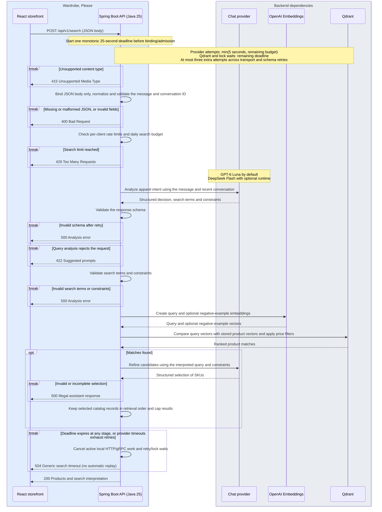

# Wardrobe, Please search request flow

This Mermaid sequence diagram uses C4 container boundaries to show a search request from the storefront to the Spring Boot API and its dependencies.

**Catalog indexing happens at startup.** If the current catalog revision needs import or repair, the backend embeds the products and stores their vectors in Qdrant before reporting ready. A complete catalog revision reuses its stored vectors. Each accepted search embeds the interpreted query and any negative examples at request time.

Qdrant can run locally or in Qdrant Cloud. OpenAI supplies embeddings with either chat provider. Catalog browsing and readiness checks use Qdrant directly.

Product refinement logs the candidate count, response time across any schema retry, model, and finish reason at INFO. DEBUG adds token usage and the final validated SKUs.

The planned [provider-managed MCP search flow](../wardrobe-be/openspec/changes/latency-first-mcp-catalog-search/design.md), [AWS edge](../openspec/changes/aws-edge-hosting/design.md), and [wake-up flow](../openspec/changes/aws-control-plane/design.md) are documented in OpenSpec.

**Planned AWS edge protection:** use AWS-managed `SecurityHeadersPolicy` and the selected CloudFront plan’s default WAF protection. No custom response-header policy, CSP, WAF rules, path exclusions or block responses are planned. Existing backend search rate limits remain unchanged; edge blocks retain AWS’s default response. Verify normal page, POST search and automated readiness requests against that default protection.

**Planned AWS traffic visibility:** use default CloudFront metrics and available console reports only, with no additional analytics charges or configuration. No access-log delivery, analytics buckets/databases, wake-event records, tracking scripts or custom reporting pipeline are planned. These reports provide approximate request/traffic information, not visitor sessions or campaign attribution. Backend operational logging remains separate.

The [storefront search benchmark proposal](../wardrobe-be/openspec/changes/archive/2026-11-21-benchmark-storefront-search/design.md) was deferred and archived as unimplemented on 2026-11-21. Its proposed endpoint evaluation and MCP comparison remain future work.

**Search transport:** [search-request-body](../openspec/changes/archive/2026-11-23-search-request-body/design.md) uses POST with an `application/json` body containing `message`, `conversationId` and optional `clearMemory` (default false). Query parameters cannot supply or override these fields. GET search returns 405 without admission; invalid or missing JSON returns 400 and unsupported content types return 415 before admission or downstream calls. Deploy the storefront and backend together.

Supported storefront requests keep search fields out of request URLs and URL access logs. This does not redact arbitrary caller-supplied query parameters or explicitly enabled body logging. No request-body logging is introduced. CloudFront POST forwarding and WAF verification remain planned in the AWS edge change.

**Implemented search timeout budget:** [search-timeout-budget](../openspec/changes/archive/2026-11-23-search-timeout-budget/design.md) retains the frontend’s 30-second timeout, introduces one 25-second backend deadline, caps provider attempts at 5 seconds/remaining time and shares at most three extra attempts across transport and schema retries. Expiry cancels local downstream work and returns a generic 504; startup indexing and health/wake probes keep their separate timeouts. `SearchBudgetFilter` scopes the synchronous request, buffers its response and clears the context on completion. Chat/embedding model wrappers, schema advisors, cancellable HTTP transports and the Qdrant channel share the budget. Native SDK/Spring retry settings must be zero; gRPC service retries and search HTTP automatic connection recovery/redirects are disabled. Schema correction retains one repeat per stage, consuming the same three-extra-attempt allowance. Retry waits honor `Retry-After` only when it fits. The frontend preserves failed input and re-checks readiness without replay. Independent retry defaults are also disabled outside search, but no search deadline is applied there. See [verification](../openspec/changes/archive/2026-11-23-search-timeout-budget/verification.md).

**Backend runtime dependencies:** [reduce-backend-memory](../openspec/changes/reduce-backend-memory/design.md) removes unused OAuth2 login dependencies and AspectJ. `ProductSearchService` records `product.search` timing in a `finally` block for successful and exceptional completion, with class/method/exception tags only. Spring Security, validation, readiness and OpenAI embeddings remain. DeepSeek's starter is commented out; provider-specific options live in an isolated compile-only adapter. An early configuration check explains how to uncomment/rebuild/select DeepSeek when its runtime is absent, before chat-dependent beans are created. Re-enabling DeepSeek chat still uses OpenAI embeddings.

[Local verification findings](../openspec/changes/reduce-backend-memory/verification.md)
are summarized in OpenSpec. The nano experiments are retired; current runtime
limits are documented below. AWS total-host and real-provider validation remain pending.

**Planned AWS schedule:** both recurring start (08:00) and stop (22:00) run Monday to Friday in Europe/Berlin. No recurring start or stop runs at weekends; visitor-triggered weekend wake and off-hours shutdown after 20–25 minutes remain available.

**Planned deployment logging configuration:** `application-aws.yml` is an ordinary Spring Boot profile activated with `SPRING_PROFILES_ACTIVE=aws`, not an AWS login profile or remote logging service. It retains payload-sensitive logger restrictions and requires verification of normal and provider-error paths.

**Java runtime:** [upgrade-backend-java-25](../openspec/changes/upgrade-backend-java-25/design.md) aligns compilation/tests on Java 25 LTS and Docker builder/runtime on Temurin 25. It replaces the initial Java 26 proposal. [Upgrade verification](../openspec/changes/upgrade-backend-java-25/verification.md) remain separate from AWS host acceptance. Earlier Java 17 cleanup measurements are historical; rollback requires the retained Java 17 artifact/image.

**Runtime memory:** `wardrobe-be/runtime-jvm.args` supplies `-Xms64m -Xmx256m`
to Docker and bootRun; direct/IDE launches load it explicitly. GC selection and
metaspace sizing use JVM defaults. The single Compose profile caps the backend
at 640 MiB without container swap. Frontend/local Qdrant use additional memory.
The planned AWS deployment uses remote Qdrant and starts with micro (1 GiB), with
small as fallback; total-host headroom and real-provider load remain unverified.
Nano experiment tooling and the alternate Compose profile have been removed.
