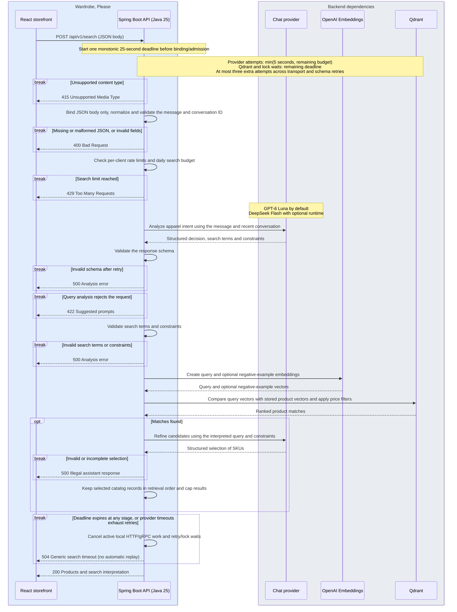
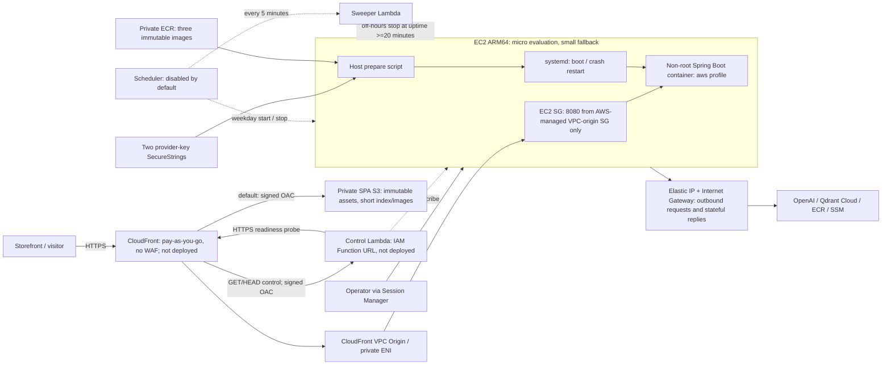

# Wardrobe, Please search request flow

This Mermaid sequence diagram uses C4 container boundaries to show a search request from the storefront to the Spring Boot API and its dependencies.

**Catalog indexing happens at startup.** If the current catalog revision needs import or repair, the backend embeds the products and stores their vectors in Qdrant before reporting ready. A complete catalog revision reuses its stored vectors. Each accepted search embeds the interpreted query and any negative examples at request time.

Qdrant can run locally or in Qdrant Cloud. OpenAI supplies embeddings with either chat provider. Catalog browsing and readiness checks use Qdrant directly.

Product refinement logs the candidate count, response time across any schema retry, model, and finish reason at INFO. DEBUG adds token usage and the final validated SKUs.

The planned [provider-managed MCP search flow](../wardrobe-be/openspec/changes/latency-first-mcp-catalog-search/design.md) is documented in OpenSpec. The [AWS edge](../openspec/changes/aws-edge-hosting/design.md) and [wake-up flow](../openspec/changes/aws-control-plane/design.md) are implemented locally; deployment and live acceptance remain pending.

**Implemented AWS edge protection (not deployed):** pay-as-you-go CloudFront without WAF, as approved on 2026-11-24. S3 and Lambda use OAC; backend uses the imported private VPC Origin. AWS-managed `SecurityHeadersPolicy` is attached to the static behavior without overrides or CSP. Included Shield Standard remains; there is no WAF application-request filtering, paid Shield, edge rate rule or wake spending cap. Backend search limits remain unchanged. API caching is disabled and configurable 5xx error minimum TTLs are zero distribution-wide without status/body remapping. Backend connections use one attempt, three seconds connect and 30 seconds response timeout; POST body/Content-Type are forwarded without rewriting. Control GET/HEAD routing precedes backend routing, so readiness probes cannot recurse into control.

**Implemented AWS traffic visibility configuration (live data pending):** use default CloudFront metrics and available console reports only, with no additional analytics charges or configuration. No access-log delivery, analytics buckets/databases, wake-event records, tracking scripts or custom reporting pipeline are planned. These reports provide approximate request/traffic information, not visitor sessions or campaign attribution. Backend operational logging remains separate.

The [storefront search benchmark proposal](../wardrobe-be/openspec/changes/archive/2026-11-21-benchmark-storefront-search/design.md) was deferred and archived as unimplemented on 2026-11-21. Its proposed endpoint evaluation and MCP comparison remain future work.

**Search transport:** [search-request-body](../openspec/changes/archive/2026-11-23-search-request-body/design.md) uses POST with an `application/json` body containing `message`, `conversationId` and optional `clearMemory` (default false). Query parameters cannot supply or override these fields. GET search returns 405 without admission; invalid or missing JSON returns 400 and unsupported content types return 415 before admission or downstream calls. Deploy the storefront and backend together.

Supported storefront requests keep search fields out of request URLs and URL access logs. This does not redact arbitrary caller-supplied query parameters or explicitly enabled body logging. No request-body logging is introduced. CloudFront POST forwarding is implemented locally; live body/header passthrough and uncached-response checks remain pending in the AWS edge change.

**Implemented search timeout budget:** [search-timeout-budget](../openspec/changes/archive/2026-11-23-search-timeout-budget/design.md) retains the frontend’s 30-second timeout, introduces one 25-second backend deadline, caps provider attempts at 5 seconds/remaining time and shares at most three extra attempts across transport and schema retries. Expiry cancels local downstream work and returns a generic 504; startup indexing and health/wake probes keep their separate timeouts. `SearchBudgetFilter` scopes the synchronous request, buffers its response and clears the context on completion. Chat/embedding model wrappers, schema advisors, cancellable HTTP transports and the Qdrant channel share the budget. Native SDK/Spring retry settings must be zero; gRPC service retries and search HTTP automatic connection recovery/redirects are disabled. Schema correction retains one repeat per stage, consuming the same three-extra-attempt allowance. Retry waits honor `Retry-After` only when it fits. The frontend preserves failed input and re-checks readiness without replay. Independent retry defaults are also disabled outside search, but no search deadline is applied there. See [verification](../openspec/changes/archive/2026-11-23-search-timeout-budget/verification.md).

**Backend runtime dependencies:** [reduce-backend-memory](../openspec/changes/reduce-backend-memory/design.md) removes unused OAuth2 login dependencies and AspectJ. `ProductSearchService` records `product.search` timing in a `finally` block for successful and exceptional completion, with class/method/exception tags only. Spring Security, validation, readiness and OpenAI embeddings remain. DeepSeek's starter is commented out; provider-specific options live in an isolated compile-only adapter. An early configuration check explains how to uncomment/rebuild/select DeepSeek when its runtime is absent, before chat-dependent beans are created. Re-enabling DeepSeek chat still uses OpenAI embeddings.

[Local verification findings](../openspec/changes/reduce-backend-memory/verification.md)
are summarized in OpenSpec. The nano experiments are retired; current runtime
limits are documented below. AWS total-host and real-provider validation remain pending.

**Implemented AWS schedule (not deployed, disabled by default):** both recurring start (08:00) and stop (22:00) run Monday to Friday in Europe/Berlin. No recurring start or stop runs at weekends; visitor-triggered weekend wake and off-hours shutdown after 20–25 minutes remain available.

**Implemented deployment logging configuration:** `application-aws.yml` is an ordinary Spring Boot profile activated with `SPRING_PROFILES_ACTIVE=aws`, not an AWS login profile or remote logging service. It retains payload-sensitive logger restrictions. Mock-provider tests cover successful query analysis, empty/schema-invalid/malformed responses and provider errors; live-host checks remain separate. Unknown refinement SKUs are logged without their untrusted values. Provider exceptions from refinement are converted to a generic assistant failure without retaining raw exception causes, preventing servlet error logging from exposing payloads. The exception handler also sanitizes OpenAI/HTTP provider failures from embedding and retrieval.

**Java runtime:** [upgrade-backend-java-25](../openspec/changes/upgrade-backend-java-25/design.md) aligns compilation/tests on Java 25 LTS and Docker builder/runtime on Temurin 25. It replaces the initial Java 26 proposal. [Upgrade verification](../openspec/changes/upgrade-backend-java-25/verification.md) remain separate from AWS host acceptance. Earlier Java 17 cleanup measurements are historical; rollback requires the retained Java 17 artifact/image.

**Runtime memory:** `wardrobe-be/runtime-jvm.args` supplies `-Xms64m -Xmx256m`
to Docker and bootRun; direct/IDE launches load it explicitly. GC selection and
metaspace sizing use JVM defaults. The single Compose profile caps the backend
at 640 MiB without container swap. Frontend/local Qdrant use additional memory.
The planned AWS deployment uses remote Qdrant and starts with micro (1 GiB), with
small as fallback; total-host headroom and real-provider load remain unverified.
Nano experiment tooling and the alternate Compose profile have been removed.

## AWS backend host

**Edge pricing decision (2026-11-24):** the owner selected pay-as-you-go without WAF. The rejected Free flat-rate plan excludes VPC Origins. The scheduled-host estimate is about €9/month with illustrative VAT and little margin; allowance availability, actual tax/FX and week-one costs remain unverified. See [edge verification](../openspec/changes/aws-edge-hosting/verification.md).

`infra/` implements the [backend-host design](../openspec/changes/aws-backend-host/design.md)
using CDK TypeScript in eu-central-1. The current repository revision replaces the
public custom-origin/header scheme with a CloudFront VPC Origin. **This revision
has not been deployed**; earlier live results apply to the old public-origin stack.
See the [runbook](../infra/RUNBOOK.md) and [verification](../openspec/changes/aws-backend-host/verification.md).
The edge distribution and control plane are also implemented locally and have not been deployed.

`bash infra/deploy.sh` is the deployment entry point for all currently registered
CDK stacks (backend host, then control plane with schedules disabled by default, then edge). Its ignored JSON config defaults to
the existing account/profile/region, reuses the stack's Qdrant hostname and requires
a budget email. The helper builds a unique ARM64 image, deploys infrastructure via
CloudFormation, pushes to ECR and uses SSM to install current host scripts/config,
restart and check local readiness. For an existing host it closes historical broad
ingress before startup and verifies the final managed-SG-only rule before activating
the new image. EC2 is stopped after verification or ordinary deployment failure by
default; keeping it running is an explicit config option. This deployment automation
also binds control to the deployed distribution and builds/uploads the SPA with cache headers. `infra/deploy-spa.sh` supports independent frontend releases, publishing dependencies before index and invalidating `/index.html` and `/`. Old hashed assets remain for open tabs/rollback. Local mocked checks
are separate from pending live acceptance.

CloudFront uses the EC2 private interface. Inbound TCP 8080 is allowed only from
`CloudFront-VPCOrigins-Service-SG`; no public CIDRs or shared CloudFront prefix-list
rules are allowed. AWS creates the service group with the VPC Origin; a deployment
SDK custom resource looks it up by VPC and name after creation, then a separate
security-group ingress resource references it. The stack never creates or edits
AWS's group. Do not share the VPC Origin with other accounts.

The public subnet's default route and Elastic IP remain for outbound IPv4 access;
security groups permit the replies without admitting unsolicited inbound requests.
No NAT Gateway is introduced. Application origin-verification filters, properties,
custom headers and SSM origin secrets are removed. Host-local readiness needs no
special header; readiness semantics and health-only Actuator exposure are unchanged.

The host retains encrypted 8 GB gp3, IMDSv2 with host-only hop limit, no SSH,
standard CPU credits, emergency swap and capped Docker/journal logs. The container
uses shared JVM arguments and 640 MiB without swap. Root-only preparation reads
two provider-key SecureStrings into `/run`, pulls ECR and starts the container.
Exact-ARN permissions and an explicit deny constrain the SSM managed baseline's
broader parameter reads. The application does not call AWS APIs.

Deploy network restrictions before activating a filter-free image, and update the
existing host's prepare script through SSM: editing EC2 user data alone does not
rerun cloud-init. Edge code must consume `WardrobeBackendVpcOriginId` and
`WardrobeBackendOriginPrivateDns`; control consumes `WardrobeBackendInstanceId` only.
The account's early $8 USD alert threshold supports the €10/month target but does
not enforce it. Recurring scheduling, capacity and warm-stop/start acceptance remain
pending; leave the host stopped outside deliberate verification until then.

## AWS control plane

`infra/lib/control-plane-stack.ts` implements two Node 22 ARM64 Lambdas outside a
VPC. Control imports the host instance ID, describes its state and starts a stopped
host. Pending/stopping states return STARTING. Running hosts return UP only after
HTTP 200 from the configured default CloudFront HTTPS `/api/v1/health` route within
two seconds, without redirects or secrets. Failures return HTTP 200 STARTING with
no-cache headers and an operational error log; missing/invalid configuration fails
closed before any EC2 call. Repeated readiness calls do not restart or extend a session.

The Function URL uses AWS_IAM. Edge binding adds `InvokeFunctionUrl` and
`InvokeFunction` (via URL only) grants for the one distribution ARN. The edge must
supply OAC and uncached control/health behaviors; that infrastructure is implemented
locally, while live acceptance remains pending. No WAF is configured. `infra/bind-control.sh` resolves the distribution domain
and redeploys control with ordinary parameters after edge creation, avoiding a
circular reference. Control exports its URL/ARN for the edge; it receives no origin
address, secret, SSM permission or visitor analytics storage.

CDK validates the frontend opening-hours JSON and uses it for both weekday Scheduler
universal EC2 targets and the five-minute sweeper. The sweeper stops only running,
off-hours hosts with LaunchTime at least 20 minutes old. DescribeInstances requires
wildcard resource scope; start/stop permissions are limited to the host ARN.
Scheduler roles trust only this account's schedule group; functions have separate
roles and one-week log retention. All schedules default disabled. The implementation
has no wake cap; the €10 operating policy and live LaunchTime, weekday/weekend,
edge-access and week-one cost checks remain pending. See the [runbook](../infra/RUNBOOK.md).
