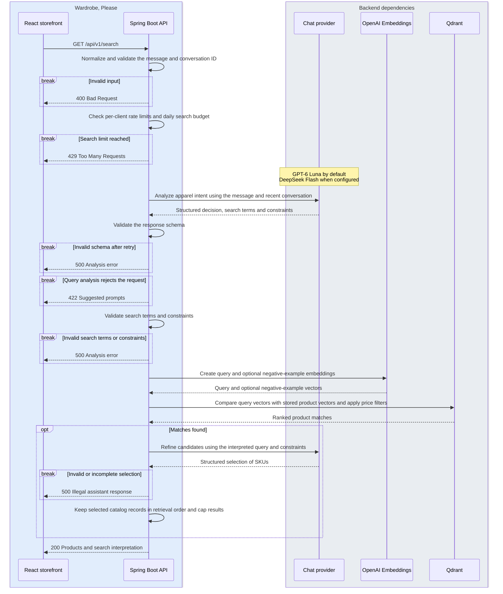

# Wardrobe, Please search request flow

This Mermaid sequence diagram uses C4 container boundaries to show a search request from the storefront to the Spring Boot API and its dependencies.

**Catalog indexing happens at startup.** If the current catalog revision needs import or repair, the backend embeds the products and stores their vectors in Qdrant before reporting ready. A complete catalog revision reuses its stored vectors. Each accepted search embeds the interpreted query and any negative examples at request time.

Qdrant can run locally or in Qdrant Cloud. OpenAI supplies embeddings with either chat provider. Catalog browsing and readiness checks use Qdrant directly.

Product refinement logs the candidate count, response time across any schema retry, model, and finish reason at INFO. DEBUG adds token usage and the final validated SKUs.

The planned [provider-managed MCP search flow](../wardrobe-be/openspec/changes/latency-first-mcp-catalog-search/design.md), [AWS edge](../openspec/changes/aws-edge-hosting/design.md), and [wake-up flow](../openspec/changes/aws-control-plane/design.md) are documented in OpenSpec.

The planned [storefront search benchmark](../wardrobe-be/openspec/changes/benchmark-storefront-search/design.md) uses this endpoint to evaluate the current flow and compare it with MCP once both are available.
